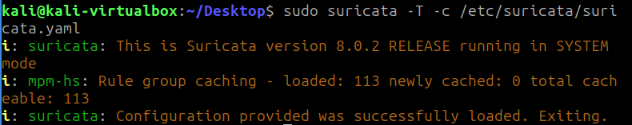
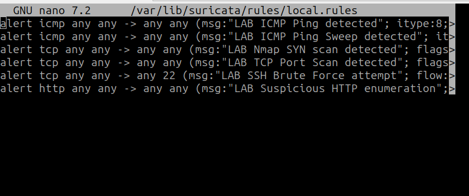
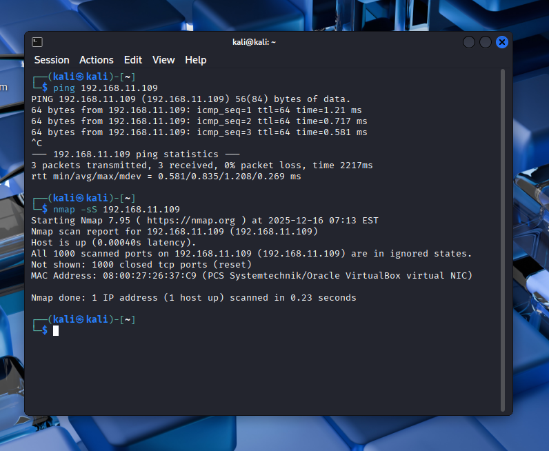
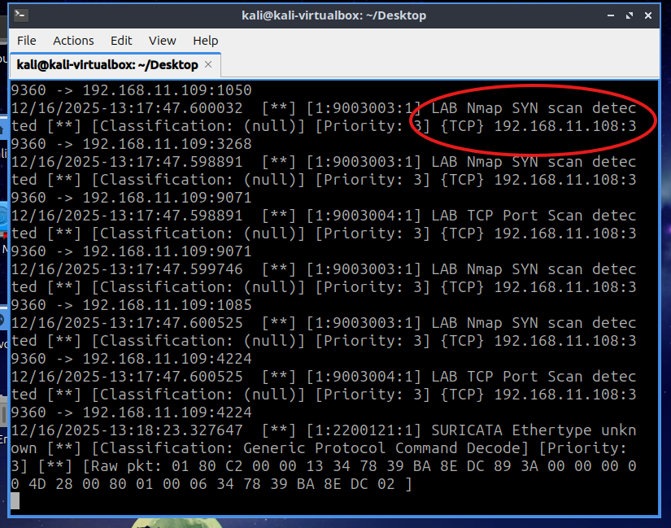
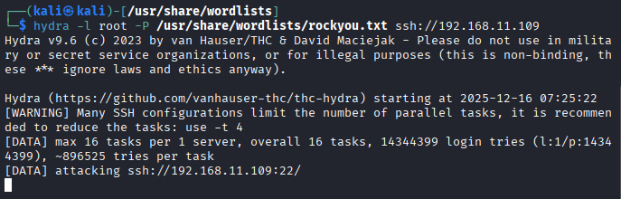
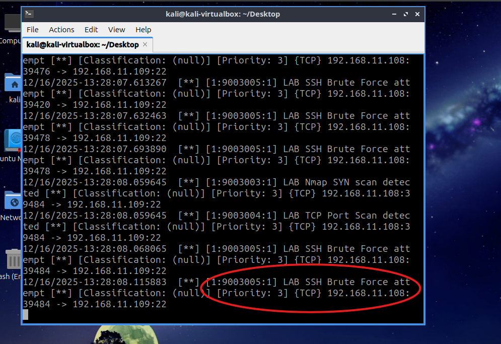
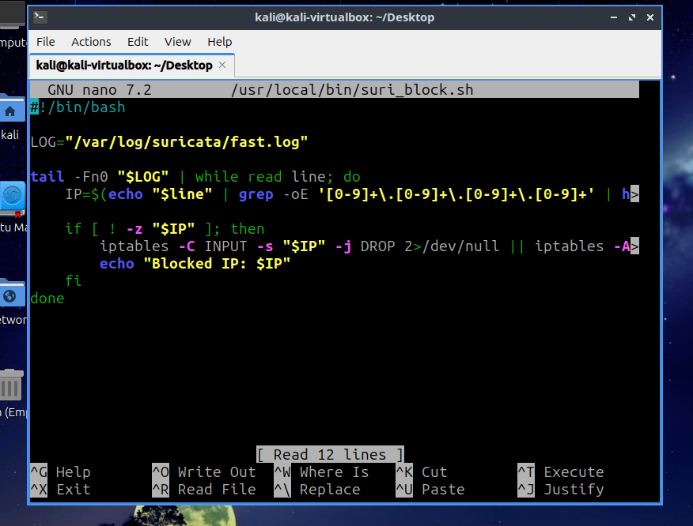
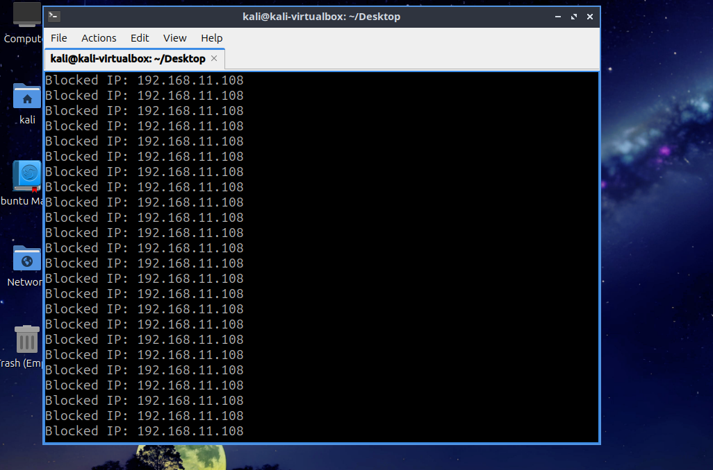
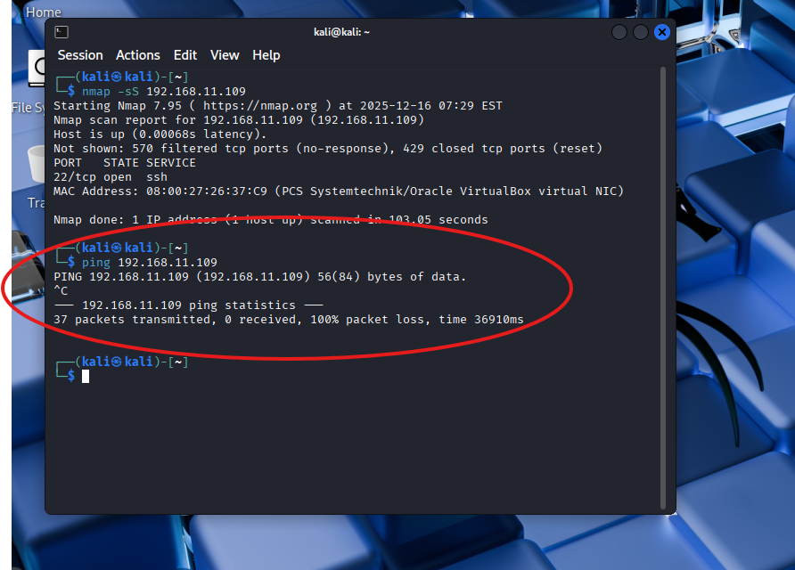

# Suricata IDS Lab: Detection and Automated Response


A home-lab project that deploys **Suricata** as a network intrusion detection system (NIDS), writes **custom detection rules** for common reconnaissance and brute-force techniques, and adds a small **automated response** script that blocks the attacking host with `iptables`.

> **Scope:** everything here was done on an isolated virtual lab that I own. Do not run the attacks shown against systems you are not authorized to test.

---

## Lab architecture

| Role | Machine | Tooling |
|---|---|---|
| Attacker | Kali Linux (VM) | `nmap`, SSH brute-force tooling |
| Victim + IDS sensor | Lubuntu (VM) | Suricata 8.0.2, `iptables`, OpenSSH |
| Network | VirtualBox bridged adapter | Both VMs on the same LAN segment |

```
 ┌────────────┐   SYN scan / ICMP / SSH brute force   ┌────────────────────────┐
 │ Kali Linux │ ────────────────────────────────────► │ Lubuntu                │
 │ (attacker) │                                       │  ├─ Suricata (NIDS)    │
 └────────────┘                                       │  │   └─ fast.log       │
        ▲                                             │  └─ suri_block.sh      │
        │            traffic dropped by iptables      │      └─ iptables DROP  │
        └──────────────────────────────────────────── └────────────────────────┘
```

## What it does

- Real-time traffic inspection with Suricata and the **Emerging Threats** rule set
- **Six custom rules** (`config/local.rules`) tuned with thresholds to reduce noise
- Detection of ICMP sweeps, Nmap SYN scans, TCP port scans, SSH brute-force attempts and Nmap HTTP user-agents
- **Automated response:** a Bash watcher tails `fast.log` and drops traffic from any source IP that triggers an alert
- Evidence of each phase (configuration, attack, detection, blocking) in `screenshots/`

## Custom detection rules

Defined in [`config/local.rules`](config/local.rules) (SIDs `9003001` to `9003006`):

| SID | Detects | Logic |
|---|---|---|
| 9003001 | ICMP echo request | Any ICMP type 8 |
| 9003002 | ICMP ping sweep | ≥ 5 echo requests from one source in 10 s |
| 9003003 | Nmap SYN scan | ≥ 10 SYN packets from one source in 5 s |
| 9003004 | TCP port scan | ≥ 20 SYN packets from one source in 10 s |
| 9003005 | SSH brute-force attempt | ≥ 5 connections to port 22 from one source in 60 s |
| 9003006 | HTTP enumeration with Nmap | `Nmap` string in the HTTP User-Agent |

Example:

```
alert tcp any any -> any 22 (msg:"LAB SSH Brute Force attempt"; flow:to_server,established;
  threshold:type threshold, track by_src, count 5, seconds 60; sid:9003005; rev:1;)
```

## Setup

```bash
# 1. Install Suricata and pull the Emerging Threats rules
sudo apt install suricata
sudo suricata-update

# 2. Install the lab configuration and custom rules
sudo cp config/suricata.yaml /etc/suricata/suricata.yaml
sudo cp config/local.rules   /var/lib/suricata/rules/local.rules   # already listed under rule-files in the provided suricata.yaml

# 3. Validate the configuration
sudo suricata -T -c /etc/suricata/suricata.yaml

# 4. Run (capture interface is set to enp0s3 in the af-packet section)
sudo suricata -c /etc/suricata/suricata.yaml --af-packet
```

Adjust the capture interface (`enp0s3`) and `HOME_NET` in `suricata.yaml` to match your own lab network.

## Test scenarios

From the attacker VM, against the victim VM:

```bash
ping <victim-ip>             # ICMP rules
nmap -sS <victim-ip>         # SYN scan / port scan rules
# repeated SSH login attempts against port 22 -> brute-force rule
```

Alerts appear in `/var/log/suricata/fast.log`.

## Results

| Step | Evidence |
|---|---|
| Configuration validated (113 rule groups loaded) |  |
| Custom rules loaded |  |
| Nmap SYN scan launched |  |
| SYN scan **detected** (SID 9003003 / 9003004) |  |
| SSH brute force launched |  |
| SSH brute force **detected** (SID 9003005) |  |
| Response script |  |
| Attacker IP **blocked** automatically |  |
| After blocking, the attacker can no longer reach the target |  |

## Limitations and lessons learned

Being honest about what this lab is and isn't:

- **Lab-grade response.** The blocking script extracts the first IPv4 address from each alert line and drops it. It has no allow-list, so it could block a gateway, DNS server or the admin's own machine. A production setup needs allow-lists, expiry of blocks, and ideally Suricata's inline IPS mode (`nfqueue`) instead of log parsing.
- **Threshold rules are simple.** The brute-force rule counts connections, not failed authentications. Pairing Suricata with `fail2ban` or auth-log analysis would be more precise.
- **Detection only covers what the sensor sees.** Encrypted traffic (SSH payloads) can only be judged by connection patterns.
- **Next steps:** forward `eve.json` to an ELK/Wazuh stack for dashboards, add MITRE ATT&CK mapping for each rule, and test false-positive rates against normal traffic.

## Repository layout

```
config/
  suricata.yaml     # Suricata configuration used in the lab
  local.rules       # Custom detection rules
screenshots/        # Evidence for every phase of the lab
```

## Disclaimer

This repository is for education and defensive security practice in a controlled environment.
